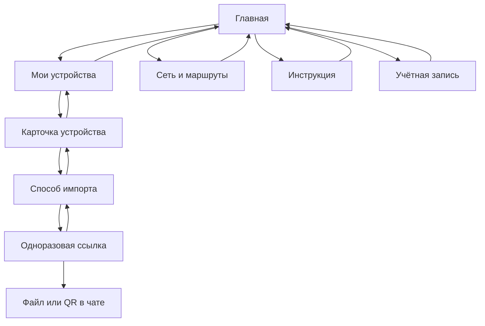
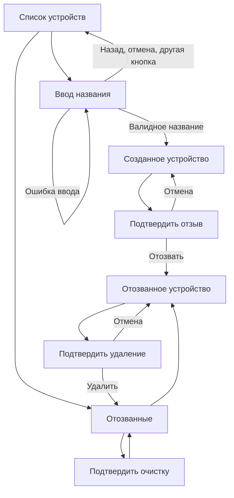
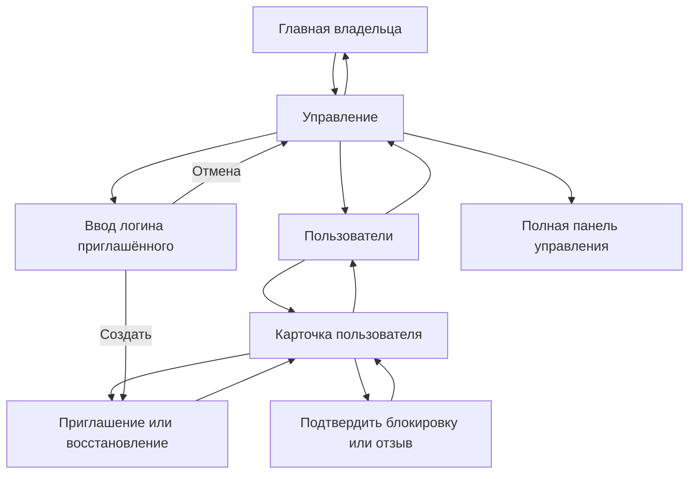

# Навигация Telegram-бота CHIMERA

Бот работает только в личном чате. После привязки одна учётная запись и один
набор устройств используются в боте и панели. Каждый экран редактирует текущее
сообщение; новый файл или QR отправляются только по явному выбору пользователя.

На экранах первого уровня есть «Главная», глубже — «Назад» и «Главная».
Списки разбиты на страницы
по шесть записей. Отозванные профили отделены от действующих; удаление доступно
только после подтверждённого применения отзыва на сервере. Ошибки возвращают
действующую навигацию, ошибочное название можно исправить следующим сообщением.

Любой переход, `/start`, `/menu` и `/cancel` очищает ожидаемый ввод. Срок ввода —
пять минут. Повторное нажатие старой кнопки заново проверяет владельца устройства,
роль пользователя и текущее состояние в БД. Команды `/invite login` и
`/block login` сохранены; блокировка через команду тоже требует подтверждения.

В 1.2 экран сети показывает страну входа, географию российских и прочих
назначений, выбранный транспорт и свежесть проверки. При зарубежном входе
бот выходит напрямую с зарубежного хоста.
